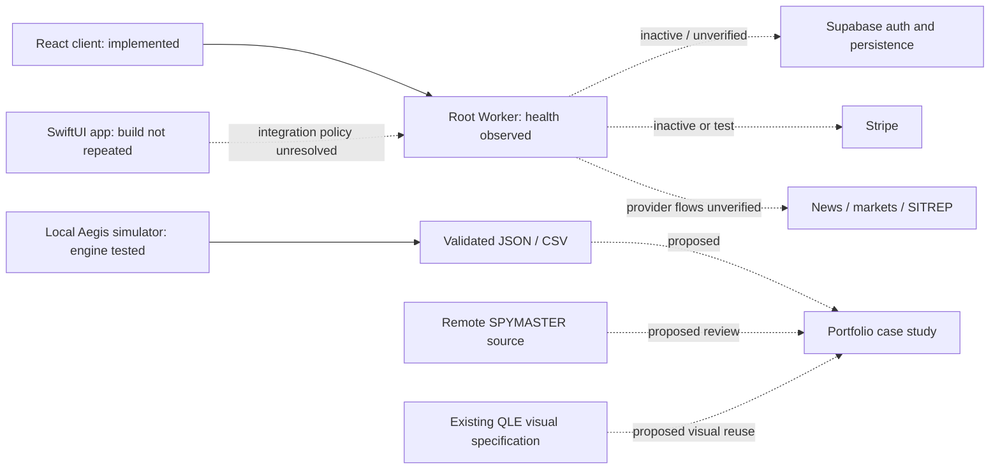

# ASTRA R&D program — initial verified baseline

Owner: Quandrix Lee Blackburn / Saint Black. Prepared 2026-10-08.
This is a bounded inspection and a proposed program, not a launch certification.
Personal military, health and financial records were not read or included.

## Outcome and evidence boundaries

The strongest near-term foundation is the existing React/Worker software plus the local QX Aegis simulator. Build on those before starting hardware or a new game engine. Keep only one implementation task active, with one queued research experiment and one queued portfolio milestone.

Verified in this session:

- Local origin is `saintblack-ai/archaios-system`, not the historical `archaios-core` name. The working tree contains extensive earlier edits and untracked work; none was reset, staged, committed or pushed.
- A read-only health GET returned HTTP 200 at `2026-10-08T05:43:51.485Z`, service `archaios-core-api`, release `2026-07-12-production-routing-contract`, dependencies `supabase: inactive`, `stripe: test_or_inactive`. This verifies that response at that moment, not authentication, persistence, live data or billing.
- The GitHub Pages URL returned HTTP 200 to HEAD. Its Last-Modified header was May 11, 2026. That header alone does not establish which source revision is deployed.
- Subsequent curl and Node health requests failed DNS resolution. This is an observation from this execution environment, not proof of a production outage. No continuous availability conclusion is justified.
- GitHub connector verified `saintblack-ai/ai-assassins-client`, default branch `main`, homepage `https://ai-assassins-client.vercel.app`, Pages enabled. It returned two successful frontend workflow runs from July 10–11. Those historical runs do not verify the current build. The historical `archaios-core` lookup returned 404: missing, private or inaccessible are unresolved alternatives.
- Connected `main/docs/game-v03/index.html` contains SPYMASTER v0.3 source. The retrieved opening source uses canvas, fixed mobile screens, `user-scalable=no` and global `touch-action:none`. Inspect gesture and zoom behavior before changing it; playability and save behavior were not tested.
- Node v24.13.1, Python, Swift and Xcode 26.6 are available; architecture is arm64. Hardware model/memory query was denied. M1 and exact RAM remain unverified. Disk probe showed roughly 18 GiB available on a 228 GiB volume. Avoid large toolchains and asset downloads.

Evidence locations are relative to this repository unless a remote URL is specified. “Verified working” below is deliberately scoped to the check stated in the row.

## Ecosystem inventory

| Project / purpose | Current evidence and status | Dependencies / blockers | Next action and acceptance criteria |
| --- | --- | --- | --- |
| ARCHAIOS SaaS backend: auth, intelligence, subscriptions | Root `worker.js`, `shared/`, `wrangler.toml`; **verified working for health response and selected local contracts only** | Live health declares persistence inactive and checkout inactive/test; secrets/account settings not inspected | Re-run readiness check; reconcile activation and account mode through read-only checks before preparing any activation. Acceptance: no healthy HTTP response is presented as paid readiness |
| AI Assassins React client: dashboard and daily workflows | `client/src/App.jsx`, pages, API adapters, pricing and workflows; **verified working for production build only** (prior turn); connected repository verified | Browser auth/checkout, remote revision alignment, sample/live labels unverified | Test signed-out shell and checkout block, then authorized test account flow. Acceptance: paid requests require session, confirmation preserves pending tier, degraded signals identify provenance |
| Stripe subscription enforcement | `tests/stripe-subscription-sync.test.mjs`, Worker implementation; **verified working in mocked local tests** | Live Stripe prices, mode, events, retries and database policies not verified | Review account configuration without edits; use a separately authorized test flow. Acceptance: all five required events covered, persistence failures not acknowledged, inactive access cannot retain paid tier |
| Daily orchestration and agents | `client/archaios-core/`, `client/scripts/`, `archaios-agents/`, root Worker cron; **implemented but unverified operationally** | Scheduler timezone, source freshness, actual run receipts and permissions | Inventory scheduled jobs and last receipts. Acceptance: each job has owner, explicit permissions, timezone, bounded cost and observable outcome; no duplicate scheduler |
| ARCHAIOS iOS Founder Edition | `ARCHAIOS_OS_iOS/README.md`, SwiftUI/SwiftData source; **implemented but unverified in this session** | Root README says no networking/auth; iOS README describes an explicit Worker/session boundary and also restricts additions | Reconcile policy documents against current sources before integrations. Acceptance: one authoritative integration policy and a reproducible build; prior physical-device claims remain historical |
| QX Aegis: benign supervisory interface experiment | `qx-aegis-simulator/src/`, core tests, `docs/NEXT_EXPERIMENT.md`; **verified working for engine/persistence tests** | Browser/mobile review not repeated; single-tab storage; authored scenario equivalence unvalidated | Use existing T1 protocol, beginning with owner-only controls rehearsal. Acceptance: traceable JSON/CSV, pauses and early ends labeled, QA separated from participants, no efficacy claim |
| SPYMASTER v0.3 | Remote `ai-assassins-client/main/docs/game-v03/index.html`; **implemented but unverified** | Source absent from bounded local filename search; remote save/controls not reviewed end-to-end | Obtain a versioned local review copy and assess mission loop, reload, keyboard and zoom. Acceptance: one playable mission, recoverable save, accessible controls; no stack replacement until inspected |
| Saint Black Assassin 3D game | User historical context; **documented concept** | Assets, runtime, target device budget and playable loop unresolved | Write one-page vertical-slice scope after existing game review. Acceptance: single mission and explicit performance budget; defer engine installation |
| QX quantum chip and division | `QX_AI_Architecture.md`, chip-planning PDF filename, QX image assets; **partial conceptual documentation** | Notebook contains illustrative unexecuted code, not measured hardware; fabrication, cryogenics, control expertise and budget absent | Produce one sourced topology/noise-model specification. Acceptance: assumptions, architecture/code compatibility and falsification criteria; no fabricated-chip claim |
| PHANTOM VEIL / thermal / EM materials | User context and research archives identified by filename; **documented concept; specific design unverified** | Material parameters, intended frequency band, geometry and measurements unknown | Begin a paraxial optical model; treat thermal/EM as separate questions. Acceptance: stated angular/aperture limits; no generalized invisibility claim |
| Truthwave / BLACK PHOENIX | User context; **documented concept** | No validated classifier or provenance pipeline established | Draft evidence/provenance labels using one licensed or owner-authored sample. Acceptance: provenance and factual accuracy scored separately; uncertain material remains uncertain |
| Hybrid human/AI, nano-material and “sand” concepts | User context and QX architecture notebook; **documented concept** | No material recipe, biological mechanism, measurement protocol or validated benefit | Limit active work to simulated sensing and supervisory UI; require definitions and evidence before biological/material claims |
| Creative archive and design | `Final books published /` EPUB/PDF/image filenames; `docs/visuals/QLE-001_VISUAL_IDENTITY.md` read; **partial, assets located** | Book contents/rights and official website ownership/routes not verified; music claims historical | Draft one portfolio case study from QX Aegis with approved visuals. Acceptance: clear prototype status, reproducibility, limitations and rights check before publication |
| QX journal / missing artifacts | `knowledge/research/README.md`, existing simulator source inventory; **partial** | Exact `QX-Department-Workspace.html` and `QX-Hybrid-Technology-Research-Thesis-v1.pdf` names not located in bounded local search | Keep unresolved-source entries; do not substitute unrelated PDFs or assert global absence |
| Black Keystone backup initiative | SQL/test/runbook filenames exist; **paused by owner instruction** | Restoration/export freshness and access not evaluated | Remain paused. Backup readiness may be documented, but no backup jobs, exports, restores or database changes were run |
| Other Workers, Supabase project and Vercel deployment | Historical names in user context; **inaccessible/unverified during this assessment** | Connected account state and deployment identity not queried | Read-only account inventory later; frontend repository homepage is evidence of a URL only |

## Charter and architecture

Mission: turn existing assets into reproducible software, bounded research and honest portfolio evidence. Do not infer research validation from narrative, rank, branding, an image or an automated test.

Three tracks only:

1. Reliable intelligence software: auth boundaries, degraded data, source attribution, observable releases and permission-limited agents.
2. Benign human-supervised research: existing Aegis presentation experiment first; quantum/optical models remain queued studies.
3. Creative translation: a prototype case study and existing game review. Theology, fiction, historical interpretation and measured findings receive separate labels.

Actual and proposed connections:



Reuse the existing auth boundary and API contracts inside the SaaS. Keep the simulator credential-free and offline; it does not need SaaS identity, subscription tables or live telemetry. Share evidence fields (source, timestamp, confidence, status, limitations) as a documentation convention before coupling databases. Reuse existing design tokens and approved assets only after legibility/rights review. Keep personal records outside portfolio inputs. Do not consolidate repositories or automatically rename infrastructure.

## Evidence and hypothesis register

Budgets below are proposed planning caps for local work, not vendor quotations or laboratory cost estimates. All experiments start with existing tools and no purchases. A professional hardware/materials budget is unknown and requires specialist scoping.

| Direction / scientific question and intended benefit | Evidence class and limits | Smallest useful work, prerequisites and budget | Success, failure, uncertainty and next decision |
| --- | --- | --- | --- |
| QX quantum chip: what connectivity/error model supports a tractable error-correction demonstration? Benefit: learn architecture tradeoffs | Established published QEC studies; QX hardware and advantage remain untested. Heavy-hex surface-code embedding has explicit overhead/tradeoffs [S1] | 4–6 h / $0 local: graph and documented noise assumptions, no full-chip simulator. Requires linear algebra/QEC expertise; cryogenic hardware/control require specialist labs | Success: reproduce one published small configuration and report overhead. Fail: unexplained disagreement or unrealistic noise. Reject advantage claims if classical baseline or noise sensitivity removes apparent gain. Then decide whether simulator installation is justified |
| PHANTOM VEIL: under which small-angle/aperture conditions does a four-lens model preserve a background path? Benefit: optics education | Established paraxial demonstrations [S2]; generalized optical/thermal/EM invisibility is untested. One spectral domain does not establish another | 3–4 h / $0 local: ray-transfer calculation with declared focal lengths and aperture. Requires geometric optics; no bench procurement yet | Success: expected paraxial transfer and explicitly bounded rays. Fail: clipping or off-axis mismatch. These failures define useful limits rather than “cloak success.” Next: peer-check model before a safe lens demonstration |
| Truthwave: can provenance labels prevent unsupported conclusions? Benefit: media literacy | Established signed-provenance standard [S3]; provenance does not prove content truth. QX classifier effectiveness untested | 2–3 h / $0: owner-authored asset, source history, uncertainty labels and a manually checked claim sheet. Requires provenance literacy and editorial review | Success: reviewer distinguishes history/authorship from truth. Fail: tampered or missing provenance becomes a false certainty. Next: decide whether a local credential verifier adds value |
| Human/AI supervisory interfaces: does QX grouping reduce missed acknowledgements or unsupported choices? Benefit: usable civilian information | Existing scripted prototype, no participant study. Hypotheses H1/H2 are explicit in T1; accuracy and timing are proxies | 2 h controls rehearsal, then 4–6 h pilot / $0 proposed. Eight consenting adults only if feasible; no recruiting performed. Human-factors/accessible design review desirable | Success: usable controls and interpretable per-session results. Fail: traps, ambiguous labels, ceiling/learning effects. No powered benefit claim. Fix those issues before expanding features |
| Epigenetic interface ideas: is there a specific mechanism with reproducible evidence connecting a non-invasive interface to the proposed outcome? | Untested speculation here; no biological benefit established and no intervention proposed | 2 h / $0: define mechanism, outcome and disconfirming evidence; obtain specialist literature review before an experiment | Success: precise, testable question with independent evidence. Fail: no mechanism or measurable outcome. Park biological work; continue ordinary software interfaces |
| Protective/hybrid materials: which specific passive material property is useful for a benign application? | No QX composition or measurement identified; hypothesis only | 2 h / $0: choose a published material and one property, record units, conditions and uncertainty. Materials expertise required before bench work | Success: reproducible literature baseline; fail: comparisons across incompatible conditions. Next: scope a safe passive sample measurement with an expert |
| Phone sensing/supervision: can users recognize stale or conflicting simulated observations? Benefit: bounded situational awareness | Aegis inputs are fictional; real sensor accuracy/latency unverified | Use T1 rather than build another interface. Later mock delayed/dropped messages with no geolocation or hardware actuation | Success: stale labels understood and no unsupported action suggested. Fail: simulated observations mistaken for live data. Next: revise labels; retain human decisions |
| QX nano-material / “sand”: what composition, scale and passive function does the term denote? | Undefined concept in inspected evidence; neither active material nor medical efficacy established | 1–2 h / $0: requirements sheet with composition, intended passive role, property and measurement. No synthesis or dust exposure experiment | Success: measurable benign property and independent references. Fail: undefined mechanism or impossible requirements. Park unless definition improves |
| Quantum Intelligence Division / research journal: can records trace each conclusion to an experiment or source? Benefit: cumulative work | Organizational concept; titles are narrative/administrative, not technical validation | 1 h / $0: adopt register fields below, no elaborate rank system required | Success: another reader can reproduce a result or identify the missing evidence. Fail: conclusions cannot be traced. Next: review one record monthly |

Record template: question; intended benefit; evidence class; source/version/date; assumptions; parameters; method; measured outputs; uncertainty; disconfirming result; limitations; decision; next action. Engineering QA and human research datasets must be labeled separately. NIST's voluntary risk framework supports contextual measurement and evaluation; it does not certify this program [S4].

Primary sources consulted during this assessment:

- [S1: IBM-affiliated comparative QEC study, 2025](https://research.ibm.com/publications/comparative-study-of-quantum-error-correction-strategies-for-the-heavy-hexagonal-lattice). Abstract inspected; full quantitative replication not performed.
- [S2: Choi and Howell, Paraxial Ray Optics Cloaking, 2014](https://digitalcommons.chapman.edu/scs_articles/817/). Primary-paper repository/search record inspected; no full optical validation performed. [Related authors' 2015 work](https://arxiv.org/abs/1506.01464) explicitly identifies the small-angle boundary.
- [S3: C2PA technical specification 2.4](https://spec.c2pa.org/specifications/specifications/2.4/specs/C2PA_Specification.html). Versioned official specification; no verifier implemented or conformance claimed.
- [S4: NIST AI RMF](https://www.nist.gov/itl/ai-risk-management-framework). Official voluntary framework; no certification claimed.

These sources support bounded established facts, not QX novelty, patentability, superiority or experimental success. Further primary review is required before substantial material, biological, thermal or electromagnetic claims.

## Three priorities and 30/60/90-day plan

Assume 2–3 hours/week initially; revise only after actual effort is known. Costs are incremental planning caps excluding existing subscriptions and personal time. No spending is authorized.

| Window | Deliverable and reason now | Time / proposed cost | Dependencies / acceptance |
| --- | --- | --- | --- |
| Immediate reliability priority — completed locally | Health-based readiness assessment: an available endpoint must not imply paid readiness | This session; no new service or dependency | Six tests pass; inactive/unknown states block; configured states remain unverified; GET only; no secrets read |
| Days 1–30 | Reconcile iOS policy; record release/source freshness; owner-only Aegis rehearsal. Reuses assets and exposes blockers before adding systems | 8–10 h total / $0 incremental | Re-run health in a network-capable context; no production modifications. Written auth/data status, one issue list, exported rehearsal labeled QA, policy conflict resolved before native networking |
| Days 31–60 — queued research priority | Existing T1 Aegis pilot or improved question design if rehearsal finds ceiling effects. Most affordable hypothesis test available | 8–10 h / $0 proposed | Stable scenarios and controls; consenting adults available without outreach by agent. Labeled per-session coverage/accuracy/missed/approximate timing; confounds documented; no health/efficacy claim |
| Days 61–90 — queued portfolio milestone | Draft one QX Aegis case study and review SPYMASTER mission/save loop. Connects credible work to audience-facing material | 8–10 h / $0 proposed | Explicit fiction/research labels; owner-authorized assets; reproducibility and limitations. Local review packet ready; publication needs separate authorization |

Commercial gate after evidence improves: validate audience demand and retention before selecting growth targets. 300 users is not necessarily 300 paying subscribers. At listed prices, reaching $8,000–$10,000 gross monthly revenue thresholds would require 164–205 all-Pro accounts or 81–102 all-Elite accounts, before fees, churn and costs. This is arithmetic, not a forecast; actual Stripe pricing remains unverified. No LLC choice, token, purchase or marketplace integration is decided here.

## Completed improvement and verification handoff

Added `scripts/assess-service-readiness.mjs` and `tests/service-readiness.test.mjs` as additive, reversible local files. Existing production verifier and deployment pipelines are unchanged. Removing these two new files reverts the implementation; preserve earlier unrelated changes.

Run:

```sh
node --test tests/service-readiness.test.mjs
node scripts/assess-service-readiness.mjs
```

The command only GETs canonical `/api/health`, has a 15-second timeout and prints a bounded report. Exit 1 means a blocker or unknown health/configuration; exit 2 means configuration was declared but actual paid flows remain unverified. It intentionally provides no “paid ready” exit. It does not replace deployment verification or inspect credentials, Stripe prices, CORS, source freshness, frontend behavior or backups.

Verification performed:

- Six new readiness tests passed, including false-positive prevention, identity failure, missing/unknown configuration, GET-only access and controlled transport errors.
- Twenty-five surrounding tests passed: runtime contracts, mocked Stripe subscription synchronization, SITREP source handling and QX engine/persistence. The QX suite includes 2,048 complete authored paths, not participant observations.
- Earlier shared navigation/accessibility improvement passed Vite production build and whitespace checks; no browser or assistive-technology study was run.
- Live execution of the new command returned a controlled DNS/transport failure and exit 1. Initial curl success and subsequent failures are recorded above; no successful live execution of the new Node command is asserted.

Next action: re-run the read-only readiness command where DNS works, then inspect activation/account settings without modifying them. Resolve the iOS documentation conflict before native integration changes. Keep Black Keystone paused. No deployment, public publishing, billing/account mutation, database change, backup job, outreach, token creation, purchase, commit or push occurred.
